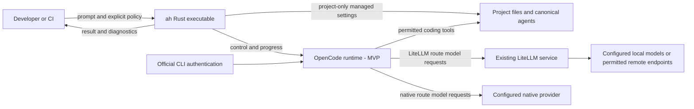
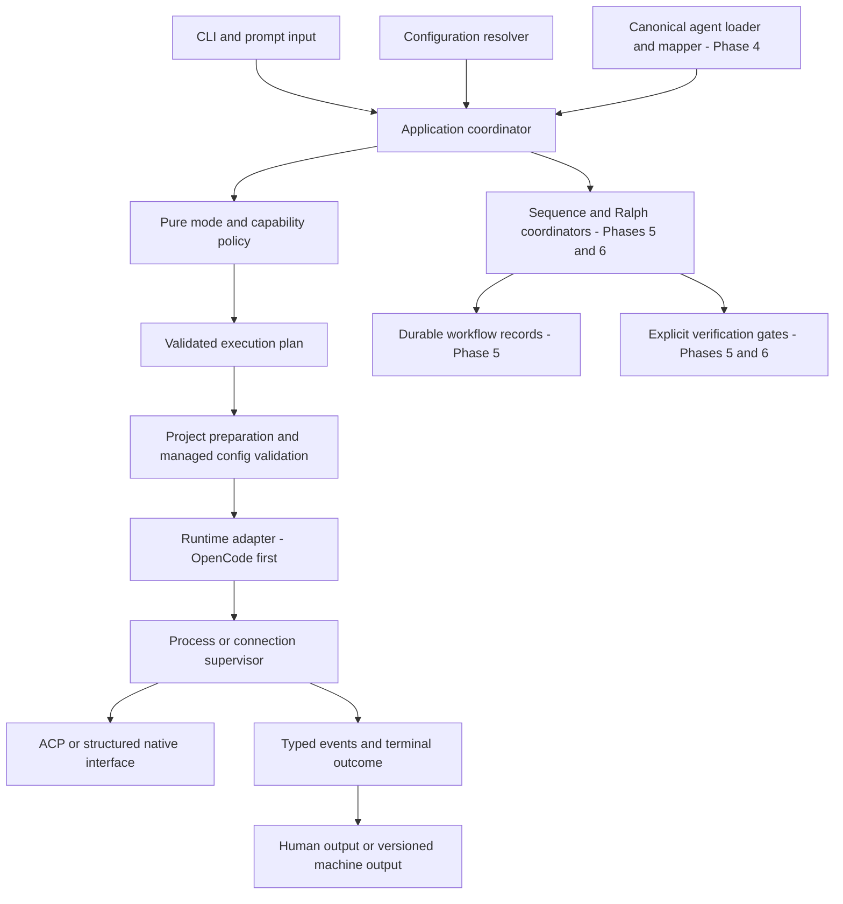
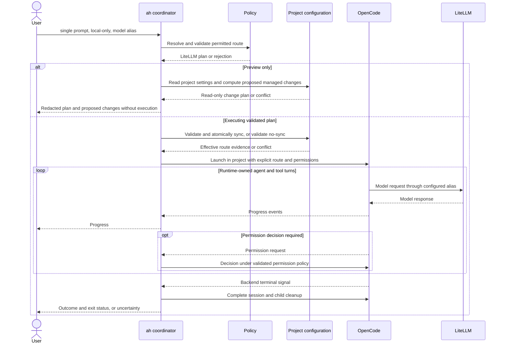
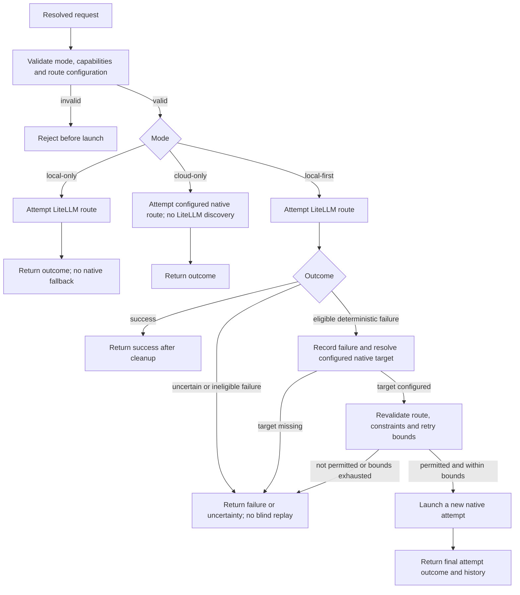
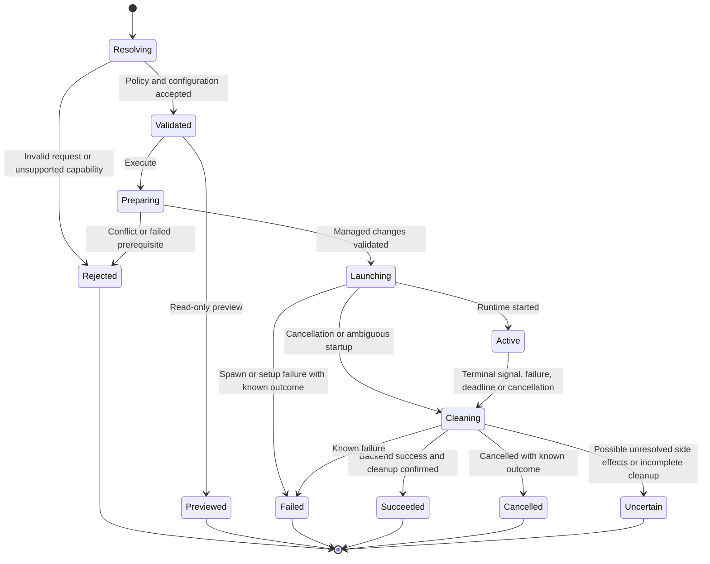
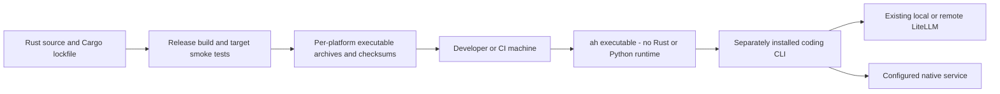

# System and software architecture

Status: target Rust architecture, not implemented components. The [specification](SPECIFICATION.md) defines requirements and MVP acceptance; [software design](DESIGN.md) defines module/data responsibilities. Concrete interfaces, dependencies and transport are validated in Phase 1; diagrams are owned by this document and updated with the implementation.

## System context and trust boundaries

The LiteLLM and native arrows represent alternative model routes selected by policy, not permission for simultaneous unrestricted traffic. The same runtime executable may serve either route. `ah` controls supported runtime configuration and permissions; it is not an OS/network sandbox for arbitrary project commands. Native credentials stay in official tools. LiteLLM environment references are passed through supported configuration without serializing literal keys.

The harness owns endpoint/group selection and desired routing policy; the existing proxy executes its internal routing. The first slice references an already configured alias. Proxy-service installation, restarts and automatic live reconfiguration are not implied. P3.3 ([D033](../DECISIONS.md#2026-11-02--d033-harness-model-groups-as-explicit-single-proxy-group-references)) adds harness group names that each resolve to one existing proxy model group, with a read-only preview handoff of required proxy groups; the harness does not synchronize or reconfigure proxy internals.

## Software components

Arrows describe responsibility/data flow; they are not a requirement to split components into crates. Start with one Cargo package and modules. The application owns attempt ordering; policy decides permitted routes; adapters implement runtime specifics; the supervisor owns resource lifetime. Workflow coordinators call the same single-run application service. They do not bypass policy or gain direct provider access.

Managed provider sync is only applied when the selected route requires it. A native plan still validates effective runtime configuration but does not modify the managed LiteLLM provider block. Agent mapping can be reused across routes after capability validation.

## First-slice execution

Every rejection/conflict stops before launch; diagram success messages do not imply those checks can be ignored. Unknown side effects or failed cleanup prevent an unconditional success claim. Phase 1 verifies which terminal signal and shutdown handshake the selected interface actually provides. A single coding run may contain many runtime-owned tool/model turns; the harness does not implement that inner loop.

## Local-first routing and fallback

All validation failures stop without launch. Missing fallback configuration, insufficient capabilities or exhausted bounds stop without a native attempt. Phase 3 fixes eligibility and retry limits. Cross-provider fallback is a new attempt, not a portable session resume. Cancellation by itself is not permission to retry.

## Run lifecycle

This is a conceptual lifecycle, not serialized enum naming. Fallback creates another attempt governed by the coordinator. Successful agent execution does not imply harness verification ran; workflow verification is a separate outcome. Distinct uncertainty exit behavior is required from Phase 2, before machine output arrives.

## Deployment and distribution

D029 selects a native locked Apple Silicon macOS archive and GitHub pre-release in Phase 2; [the release runbook](OPERATIONS.md#maintainer-release-procedure) describes the manual build/smoke/publication process. The diagram shows the eventual release pipeline; current packaging is not automated CI. Expanded supported platforms are declared in Phase 4 after tests. A binary build does not prove process-tree cleanup on every platform. Native CLIs retain their own installation/runtime prerequisites. No mandatory daemon, hosted control plane, Python bridge or ai-queue runtime dependency is introduced.

## Ownership and persistence

| Concern | Owner / boundary |
|---|---|
| Mode, allowed routes, model groups, fallback | Harness policy and configuration |
| Internal model routing | Existing LiteLLM service using validated desired configuration |
| Managed OpenCode provider/agent content | Harness project transaction; preserve unrelated/global content |
| Native login and credentials | Official runtime/provider tooling |
| Inner agent loop, project tools and context management | Existing coding runtime |
| Attempt lifetime and normalized outcomes | Harness coordinator/supervisor |
| Sequence/Ralph state and verification | Harness outer workflows in Phases 5–6 |

Single runs can keep records in memory and report an outcome; no database is required. Workflow records are filesystem-based and versioned before Phase 5 persistence ships. Managed config/state writes need conflict handling and atomicity chosen for their platform. Dirty-project awareness is not automatic backup or rollback: the harness must not erase user work as setup/recovery, while authorized backend edits may change project files.

## Extension boundaries

Add native CLIs and Pi through adapters and capability reports rather than separate mode implementations. Keep provider-specific details at the edge; do not build a plugin SDK, general DAG scheduler or custom coding-agent framework before a product decision requires one.

Detailed contracts: [execution](EXECUTION.md), [configuration and agents](CONFIGURATION.md), [workflow state](WORKFLOWS.md), [validation](TESTING.md), and [operations](OPERATIONS.md). [FEATURE_REVIEW.md](FEATURE_REVIEW.md) owns feature dispositions.
