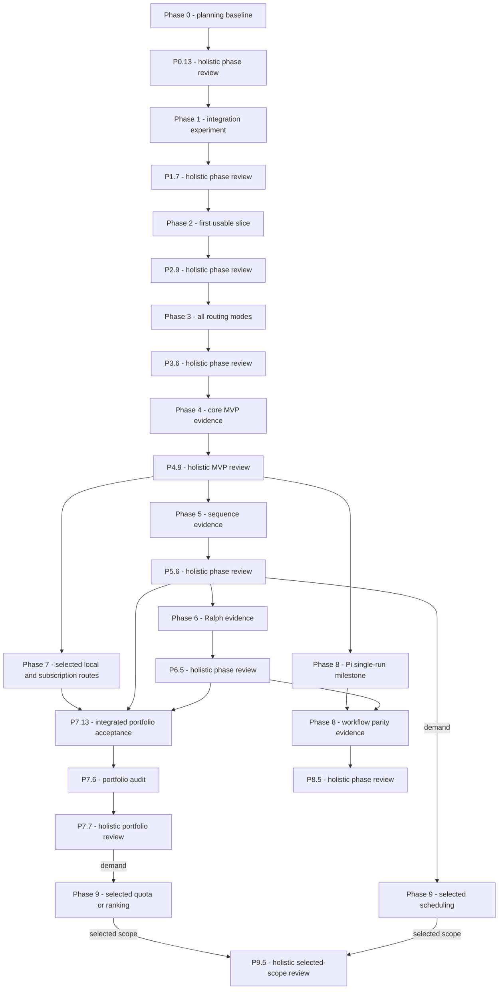

# Project execution plan

D068 implements work package 1 of the [subscription action plan](SUBSCRIPTION_ACTION_PLAN.md): the Phase 7 selected portfolio is existing OpenCode/LiteLLM, Claude and separately gated OpenCode ChatGPT-plan/Go routes. Codex/Grok remain deferred and Antigravity blocked outside mandatory closure. Pi stays independent; F27/F28 stay candidates. PROJECT.md owns current work status; historical phase order below remains traceable.

Planning baseline: 2026-11-01. This turns the phase roadmap into executable work; it does not begin implementation or adopt deferred libraries. [SPECIFICATION.md](SPECIFICATION.md) owns requirements/AC01–AC11, [IMPLEMENTATION.md](IMPLEMENTATION.md) owns phase exit criteria, [PROJECT.md](../PROJECT.md) owns status, and [tasks/](../tasks/README.md) owns per-task dependencies and evidence.

## Milestones and dependencies

Quota requires the selected-portfolio Phase 7 review P7.7 under D068 plus demand and a relevant non-spending usage path; D018 supersedes the earlier first-completed-adapter shortcut. Phase 8 initial single-run support may ship after core MVP; complete workflow parity waits for Phase 6. Quota/ranking and scheduling are independent optional increments; neither blocks core workflows.

## Recommended order and PR boundaries

| Delivery | Recommended task order | Reviewable work packages / gate |
|---|---|---|
| Integration | P1.1 → P1.6 → P1.2 → P1.4 → P1.3 → P1.5 → P1.7 | Scaffold; permission policy; working transport experiment; narrow reuse decision; lifecycle/route evidence; experiment closeout. Permission policy precedes any live prompt. |
| First slice | P2.1 → P2.3 → P2.2 → P2.4 → P2.7/P2.8 → P2.5 → P2.6 → P2.9 | Config/CLI contract; managed sync; vertical run; supervisor/output; diagnostics/project preservation; artifact; real-use gate. Use the slice before expanding. |
| Routing | P3.1 → P3.2 → P3.3 → P3.4 → P3.7 → P3.5 → P3.6 | Failure policy; native isolation; group references then configured fallback as separate PRs if needed; matrix; OpenCode 2.2.5 baseline (D035); use gate. |
| Core MVP | P4.1 → P4.2 → P4.3 → P4.7/P4.8 → P4.4 → P4.5 → P4.6 → P4.9 | Agent schema/emitter/constraints; machine output and capability documentation; role acceptance; release support; AC01–AC11 closeout. |
| Sequences | P5.5 → P5.1 → P5.2 → P5.3 → P5.4 → P5.6 | Trusted checks (first, per the Phase 4 review and D043); state/context decision; ordered execution; durable resume; interrupted live task. |
| Ralph | P6.1 → P6.2 → P6.3 → P6.4 → P6.5 | Completion contract; iteration coordinator; verification/bounds; real completion/non-completion/recovery. |
| Local/subscription portfolio | P7.8 → P7.10 → P7.12 → P7.14 → P7.13 → P7.6 → P7.7 (D103) | Go feasibility on the production ACP path, Go native target and local-first fallback, configurable ordered fallback chain, then portfolio, audit and review. ChatGPT-plan P7.9/P7.11 and paused P7.3–P7.5 keep their gates outside closure. |
| Pi | P8.1 → P8.2 → P8.3; then P8.4 after P6.5 → P8.5 | Integration decision; adapter; primary/specialized live use; later common-workflow regression. |
| Optional resources | P9.1 → P9.2 if selected; P9.3 independently after P5.6; P9.4 evidence then P9.5 review per selected increment | After P7.7 for quota, or P5.6 for scheduling, demand decision first. P9.5 reviews the entire selected increment set; newly selected work reopens the gate without forcing other optional scope. |

A slash between P2.7/P2.8 or P4.7/P4.8 denotes sibling tasks that are both required; the historical P7.11/P7.12 slash is superseded by D103's linear order. A slash does not authorize simultaneous agents or impose a provider order. Default work-in-progress limit is one active implementation task/PR. Tightly coupled work may share a PR with prerequisite evidence produced before consumption; broad cards should be split into small PRs rather than one phase-sized change. Task IDs remain stable even when work order differs from numeric order.

## Phase review gates

Every phase includes an explicit whole-phase review after acceptance evidence is assembled. Use [PHASE_REVIEW.md](PHASE_REVIEW.md), record all findings/fixes/verification in docs/reviews/, and keep the phase open until no unresolved finding remains and required review/fix PRs merge. These reviews are additional to individual PR reviews. Successor dependencies consume accepted review tasks, not only prior live demonstrations.

## Path to working use (D103)

**Usable now, from a source build** (`cargo build --release --locked`; the published alpha.2 still requires OpenCode 2.2.5):
- `local-only` through LiteLLM, with OpenCode 2.3.x (tested through 2.3.2) or Pi 1.5.0;
- `cloud-only` through Claude Code 2.1.314 or the OpenCode Zen API-key route;
- `local-first` with a Claude or Zen fallback when the proxy is unreachable;
- named agents, `--verify`, sequences and Ralph.

Use these on sample projects now and record friction for P7.13. See [OPERATIONS.md](OPERATIONS.md).

The steps below deliver the configurable fallback chain (recommended local → Go → Claude, opt-in Zen last) and close Phase 7. Blocking operator actions come first, because the agent cannot perform them.

### Operator actions that unblock later steps

| # | Action | Unblocks | How |
|---|---|---|---|
| U1 | Approve D103 | Everything below | Complete: D103 merged in PR #129 after review. |
| U2 | Hold minor/major pins | Every gate | Do not upgrade OpenCode past `2.3.x` (`2.4+` stops the gate), Claude Code (`2.1.314`) or Pi (`1.5.0`) until Phase 7 closes. SemVer patch releases in `2.3.x` are accepted under D104. |
| U3 | Prepare the Go account | Step 3 live check, step 4 | In OpenCode Console, confirm the workspace holding the Go subscription, its active Go plan, and **Extra Usage off** on the Go page. Create an API key in that workspace and export it in your shell profile under a name you choose (for example `OPENCODE_API_KEY`). The harness reads only the configured name and never stores it. |
| U4 | Attest before each live run | Each live acceptance in steps 3–6 | When asked, reply with the current time, time zone and a confirmation that the U3 workspace, plan and Extra Usage-off state are still true. Recheck after any account or plan change. |
| U5 | Choose the fallback chain | Step 5 | Confirm the step order (recommended: Go, then Claude) and each step's model. Say whether to append a Zen step and which model (metered, or a free Zen model); confirm any metered spend is your choice and fund the Console balance if so. |
| U6 | Report natural Go exhaustion | Step 5 live evidence | Never force it. If Go reports its usage limit during ordinary use, keep the run (`ah sequence show` / `ah ralph show`, or the terminal output) and tell the agent. Until then, step 5 records synthetic-only evidence as a stated limitation. |
| U7 | Keep LiteLLM and Claude ready | Steps 4, 6 | Keep the proxy at its configured `api_base` with its key exported. Stay logged in with `claude`. Before 2027-02-08 or any Claude Code pin change, the agent rechecks Anthropic terms. |

### Agent steps

1. **D103 scope patch.** Done when U1 merges.
2. **Offline-suite hygiene patch.** Two 2.2.5 suites depend on an optional `/tmp` checkout that the system emptied. Make that dependency explicit so the full offline suite is reliably green. No operator action.
3. **P7.10 Go feasibility on the ACP path.** Audit the pinned 2.3.0 `opencode-go` registration, endpoint, helper and limit-error surfacing; extend the fake-runtime fixtures; run setup review, then one live no-tool prompt. Needs U2–U4.
4. **P7.12 Go native target.** Schema, implementation and docs, then live coding and constrained review. Afterwards, `local-first` falls back from an unreachable proxy to Go. Needs U3, U4 and U7.
5. **P7.14 Configurable fallback chain.** A decision finalizing the chain schema and replacing D034 for configured chains, then fixture-proven Go and Claude limit classifiers and implementation. Afterwards `local-first` walks the configured steps in order. Needs U5; U6 supplies live evidence when it happens.
6. **P7.13 portfolio acceptance.** Local, Claude, Go and the chain through single runs, sequences and Ralph, with interruption/recovery. Needs U4 and U7.
7. **P7.6 audit, then P7.7 holistic phase review.** Review PR, then remediation `patch/` PRs one at a time. Phase 7 closes.
8. **Release `0.1.0-alpha.3`** from accepted source through the maintainer procedure in [OPERATIONS.md](OPERATIONS.md). A source build remains usable until then.

**Known limitations:** D034 falls back only when the proxy is unreachable before launch. A reachable proxy whose local model fails does not fall back to Go; broadening that trigger is a later candidate. A step advances to the next only when its limit is hit before any work ran; exhaustion after a permission grant or project change stops for explicit recovery.

## Current execution entry point

D103 supersedes the history below for ordering; it is kept as a record.

P7.8 scope reconciliation has merged. The [P7.9 bounded assessment](evidence/p7-9-chatgpt-feasibility.md) selects installed OpenCode 2.2.5 ChatGPT token-sharing for investigation but leaves feasibility unpassed (D069). The [contained-diagnostic continuation](evidence/p7-9-contained-diagnostics.md) (D070) resolves the spawn/transport blocker and verifies current-host sources plus project/parent canaries and agent rules. The [source/state assessment](evidence/p7-9-source-state-controls.md) (D071) identifies missing system/global exclusions in the selected CLI/server chain and mixed credential/integration persistent state. Its recorded stop condition was met before installed expansion; P7.9 remains unchecked and P7.11 blocked. Resumption needs a separately evidenced safe source-control plan and synthetic persistent-state proof before a D047 exclusive-state login decision. No login-store reads/copies or authentication/session/model calls are authorized. The [P7.10 dedicated Go source assessment](evidence/p7-10-go-feasibility.md) (D072) carries these limits forward and stops before installed checks. Full P7.10 remains unchecked and P7.12 blocked; the inspected allowance query cannot verify Extra Usage off. The [shared source-control design](evidence/p7-9-source-boundary-design.md) (D073) establishes a synthetic macOS data/metadata read-denial candidate under P7.9/D071. D073 planned a separately gated installed no-auth continuation combining D070 transport with that boundary and proving effective resource/synthetic persistent-state controls. The design does not establish installed equivalence or full feasibility for either route. The [pre-launch resource matrix](evidence/p7-9-resource-observation-matrix.md) (D074) met the stop condition before launch. The [observer/refusal design](evidence/p7-9-observer-refusal-design.md) (D075) then selected a sentinel-settled list observer and static plugin/instruction guards, resolving every row for fresh per-run state while keeping retained-state pairs blocked. The [installed observation](evidence/p7-9-installed-observer.md) (D076) ran those pairs and passed every row for fresh unauthenticated state, adding native-only MCP and ancestor discovery-name denials. The [exclusive-state decision](evidence/p7-9-exclusive-state-decision.md) (D077) selects a dedicated harness-owned root for an operator-run official login, gated by a retained-state preflight. The [retained-state experiment](evidence/p7-9-retained-state-experiment.md) (D078) ran its paired proofs without authentication. Every row passes or is refused for the expected reason, and only the login invariant is left. Next is a bounded, operator-authorised login into a fresh dedicated root, followed by a no-inference preflight. The operator runs the official login personally. Independent Pi continuation remains available. P7.11/P7.12 finalize consuming contracts before production and bounded live acceptance. If feasibility fails, record the blocker and a separate alternative decision rather than weakening the gate.

P7.13 requires accepted P5.6/P6.5, P7.12 and P7.14 (D103); it feeds P7.6/P7.7. Phase 8 is accepted on `main` ([phase-08 review](reviews/phase-08.md), P8.5 remediation [PR #106](https://github.com/awesomejt/agent-harness/pull/106)). The [P7.9 closeout assessment](evidence/p7-9-feasibility-closeout.md) (D089) separates no-inference feasibility from P7.11 live acceptance. After the operator-run login, the fixed D085 integration inventory refused the retained root. The [pinned catalog investigation](evidence/p7-9-catalog-investigation.md) (D090) establishes source-level cached-catalog precedence without inspecting that root. The [D091 disposable catalog-control helper](evidence/p7-9-catalog-control.md) has received initial review, but installed execution refused before launch because the accepted executable hash is unavailable on the upgraded host. D092 requalifies the production runtime on 2.3.0 but preserves the separate P7.9 pin. Next, review fresh 2.3.0 source/plugin derivation and observer/containment requalification on disposable unauthenticated roots, then record installed explicit-catalog/cache proof; authenticated expansion waits for that evidence and a revised control plan. Same-root D085–D088 installed passes, including a fresh credits-off attestation, remain pending. Merged helpers alone do not pass feasibility or unblock P7.11. D034 remains a compatibility constraint, not a new P7.9 live experiment. Physical locality (F28) and F27's remaining parts require later candidate-promotion decisions; D103 promotes F27's configurable chain as P7.14. Optional Phase 9 work still requires explicit demand; P9.1 waits for P7.7 and a supported non-spending usage path, P9.3 for P5.6. See PROJECT.md for mutable status.

## Decision gates

| Before consuming work | Required choice/evidence | Record |
|---|---|---|
| Live transport experiment | P1.1 package/toolchain baseline and P1.6 permission policy | Phase 1 decisions and experiment evidence |
| First-slice writes/launch | Config/input/exit/deadline contracts and transactional project ownership | P2.1/P2.3, CONFIGURATION.md / EXECUTION.md |
| Automatic fallback | Failure eligibility, retry bounds and uncertain-effect handling | P3.1; native isolation in P3.2 |
| Agent/machine interface | Canonical schema/destinations, supported constraints and output version | P4.1/P4.3/P4.7 |
| Durable state | Version/location/concurrency/retention/trust and resume behavior | P5.1/P5.5 |
| Iterative execution | Completion verification and hard iteration/time bounds | P6.1 |
| Subscription routes | Pinned feasibility/control evidence, explicit provider/auth/schema design, account-control limits and separate live gate | P7.9–P7.12; CONFIGURATION.md / EXECUTION.md before consumption |
| New runtime/resource increment | Selected target/use case plus supported integration and constraints | P7.1/P8.1; explicit Phase 9 demand selection |

These gates reference the deferred decision register in DECISIONS.md. Do not resolve every later choice now. If experiment evidence requires a design change, record the decision and update contracts/dependencies before proceeding.

## Risks and evidence checkpoints

| Risk / uncertainty | Earliest owner | Response / required evidence |
|---|---|---|
| OpenCode interface lacks required route/permission control | P1.2/P1.3 | Prove effective behavior; compare the supported structured-output alternative, restrict unsupported paths or record a blocking limitation. Do not build a new agent loop as an implicit workaround. |
| LiteLLM/model alias unavailable | P1.2 | Record sanitized endpoint/model failure and next validation action; continue offline lifecycle/fixture checks but leave live closeout open. |
| Cancelled/disconnected coding has unknown effects | P2.4/P3.1 | Distinct uncertainty outcome and no blind replay; controlled child plus real-use evidence. |
| Managed config conflicts with user/global content | P2.3 | Atomic conflict-aware writes, preserved unrelated settings and no literal keys; sentinel/concurrency tests. |
| Packaging/platform lifecycle differs | P2.5/P4.5 | Advertise only tested targets, smoke actual artifacts and verify cancellation; no universal portability promise. |
| Later adapter mapping broadens restrictions | P4.3/P7.x/P8.2 | Capability checks and explicit refusal; integration evidence per supported version. |
| Planning grows into a second state system | Planning/each closeout | PROJECT.md alone owns task status; static cards own acceptance/dependencies, not runtime queue state or duplicated mutable boards. |

## Definition of done and phase use

A task is done only after its card's deliverable/evidence exists, relevant contracts/decisions are updated, required checks/live observations pass and repository PR/review/merge cleanup is complete. Missing live evidence remains visible. A phase closes only after every mandatory task, its phase-use evidence and the holistic review with resolved/verified findings, not just compilation or mocked tests.

After the first slice and each usable increment, record actual project task, tested versions/route/model, outcome, manual interventions, setup friction, direct-tool comparison and follow-ups in PROJECT.md. Reprioritize from that evidence while preserving MVP policy/constraints. No time estimates or delivery dates are asserted before initial integration provides a basis.

D093 supplies the [2.3.0 public-source/plugin qualification and observer contract](evidence/p7-9-230-source-requalification.md). Consume that manifest in a separately reviewed disposable observer/containment helper before installed qualification, catalog proof or authenticated expansion. Source-only acceptance does not migrate existing helper pins.

The [D094 disposable observer](evidence/p7-9-230-disposable-observer.md) records a reviewed installed attempt and its required warning stop. Consume a separately reviewed source-first warning assessment/diagnostic plan before further installed attempts; neither partial fresh-state passes nor the merged helper unblock catalog or authenticated qualification.

The [D095 source-first warning assessment and diagnostic plan](evidence/p7-9-230-warning-assessment.md) establishes shared-log ownership across the server and both debug clients without diagnosing D094’s deleted warning. Next implement the strict, offline-tested diagnostic helper and obtain setup review before its bounded disposable control/denial pair. The warning refusal and all later installed/catalog/authenticated gates remain unchanged.

The [D096 disposable warning diagnostic](evidence/p7-9-230-warning-diagnostic.md) implements D095. Helper/setup review precedes its inherited controls and fresh listing-allowed/denied pair; any unexpected result stops and requires a separately reviewed continuation. This does not complete the matrix or unblock catalog/authenticated work.

The [D097 parent-watch assessment](evidence/p7-9-230-parent-watch-assessment.md) rejects global watcher disable and warning exceptions as remedies. Next is a separate offline-tested primitive listing/watch helper, setup review, then one bounded disposable pair; no OpenCode rerun or case 4–6/catalog/authenticated advancement follows from this source-only record. Any primitive result needs a separately reviewed remedy/OpenCode continuation decision.

The [D098 primitive helper](evidence/p7-9-230-parent-watch-primitive.md) implements D097. Setup review precedes one disposable listing/watch pair and result review precedes merge. Either result still requires a separately reviewed remedy/OpenCode continuation and does not advance cases 4–6, catalog or authenticated gates.

The [D099 created-state inventory](evidence/p7-9-230-state-inventory.md) follows D098's `state-created` stop. It keeps that refusal and adds a metadata-only inventory before one setup-reviewed attempt; any remedy for created state needs a further reviewed decision and cases 4–6, catalog and authenticated gates stay unchanged.

The [D100 Bun cache control](evidence/p7-9-230-bun-cache-control.md) reruns D099 with Bun's runtime transpiler cache disabled, keeping the state gate exact, so the D098 denied leg can run once after setup review. Any primitive result still needs a separately reviewed continuation; cases 4–6, catalog and authenticated gates stay unchanged.

The [D101 case 3 retirement](evidence/p7-9-230-retire-case-3.md) removes the listing-denied installed row, which cannot pass its gates by design, and records the resulting coverage gap and boundary invariant. Cases 4–6 follow only through a separately reviewed continuation; catalog and authenticated gates stay unchanged.

The [D102 matrix rerun](evidence/p7-9-230-cases-4-6.md) runs D094 cases 1, 2, 4, 5 and 6 once, through the unchanged D094 helper and environment, after setup review. A pass closes the disposable no-auth qualification without case 3; catalog and authenticated gates stay unchanged.
