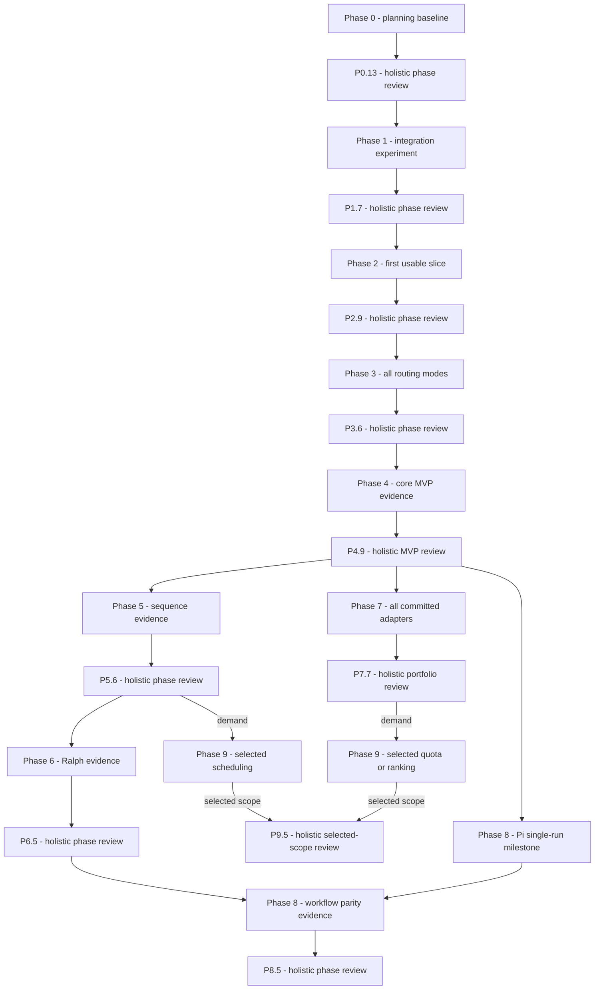

# Project execution plan

The [subscription action plan](SUBSCRIPTION_ACTION_PLAN.md) records the proposed adjustments after D066/D067. Its first work package reconciles this baseline and the Phase 7 portfolio; existing dependencies remain effective until a successor decision and contract changes are accepted. PROJECT.md owns current work status.

Planning baseline: 2026-11-01. This turns the phase roadmap into executable work; it does not begin implementation or adopt deferred libraries. [SPECIFICATION.md](SPECIFICATION.md) owns requirements/AC01–AC11, [IMPLEMENTATION.md](IMPLEMENTATION.md) owns phase exit criteria, [PROJECT.md](../PROJECT.md) owns status, and [tasks/](../tasks/README.md) owns per-task dependencies and evidence.

## Milestones and dependencies

Quota now requires the full Phase 7 review P7.7 plus demand and a relevant non-spending usage path; D018 supersedes the earlier first-completed-adapter shortcut. Phase 8 initial single-run support may ship after core MVP; complete workflow parity waits for Phase 6. Quota/ranking and scheduling are independent optional increments; neither blocks core workflows.

## Recommended order and PR boundaries

| Delivery | Recommended task order | Reviewable work packages / gate |
|---|---|---|
| Integration | P1.1 → P1.6 → P1.2 → P1.4 → P1.3 → P1.5 → P1.7 | Scaffold; permission policy; working transport experiment; narrow reuse decision; lifecycle/route evidence; experiment closeout. Permission policy precedes any live prompt. |
| First slice | P2.1 → P2.3 → P2.2 → P2.4 → P2.7/P2.8 → P2.5 → P2.6 → P2.9 | Config/CLI contract; managed sync; vertical run; supervisor/output; diagnostics/project preservation; artifact; real-use gate. Use the slice before expanding. |
| Routing | P3.1 → P3.2 → P3.3 → P3.4 → P3.7 → P3.5 → P3.6 | Failure policy; native isolation; group references then configured fallback as separate PRs if needed; matrix; OpenCode 2.2.5 baseline (D035); use gate. |
| Core MVP | P4.1 → P4.2 → P4.3 → P4.7/P4.8 → P4.4 → P4.5 → P4.6 → P4.9 | Agent schema/emitter/constraints; machine output and capability documentation; role acceptance; release support; AC01–AC11 closeout. |
| Sequences | P5.5 → P5.1 → P5.2 → P5.3 → P5.4 → P5.6 | Trusted checks (first, per the Phase 4 review and D043); state/context decision; ordered execution; durable resume; interrupted live task. |
| Ralph | P6.1 → P6.2 → P6.3 → P6.4 → P6.5 | Completion contract; iteration coordinator; verification/bounds; real completion/non-completion/recovery. |
| Native portfolio | P7.1 → selected P7.2/P7.3/P7.4/P7.5, one at a time → P7.6 → P7.7 | Each adapter may have launch/events, permissions/mapping and acceptance PRs. Docs and live evidence ship with each adapter. Portfolio closure waits for all four. |
| Pi | P8.1 → P8.2 → P8.3; then P8.4 after P6.5 → P8.5 | Integration decision; adapter; primary/specialized live use; later common-workflow regression. |
| Optional resources | P9.1 → P9.2 if selected; P9.3 independently after P5.6; P9.4 evidence then P9.5 review per selected increment | After P7.7 for quota, or P5.6 for scheduling, demand decision first. P9.5 reviews the entire selected increment set; newly selected work reopens the gate without forcing other optional scope. |

A slash between P2.7/P2.8 or P4.7/P4.8 denotes sibling tasks that are both required; a slash between native-adapter IDs denotes target choices activated one at a time. It does not authorize simultaneous agents or impose a provider order. Default work-in-progress limit is one active implementation task/PR. Tightly coupled work may share a PR with prerequisite evidence produced before consumption; broad cards should be split into small PRs rather than one phase-sized change. Task IDs remain stable even when work order differs from numeric order.

## Phase review gates

Every phase includes an explicit whole-phase review after acceptance evidence is assembled. Use [PHASE_REVIEW.md](PHASE_REVIEW.md), record all findings/fixes/verification in docs/reviews/, and keep the phase open until no unresolved finding remains and required review/fix PRs merge. These reviews are additional to individual PR reviews. Successor dependencies consume accepted review tasks, not only prior live demonstrations.

## Immediate ready queue

0. **Prerequisite: P0.13.** Complete the holistic scope/design/task-plan review and accept its report before implementation.
1. **Then: P1.1.** Create the minimal Rust package and record package/toolchain/target choices. Scope excludes agent-loop implementation, provider expansion and later command skeletons.
2. **Next: P1.6.** Specify/test permission handling before a live integration call.
3. **Then: P1.2.** Prove the OpenCode transport in a disposable project against an existing LiteLLM alias.
4. Complete the reuse/lifecycle evidence and P1.5 acceptance preparation, then pass P1.7 holistic review; only then start Phase 2's config and usable run.

At this planning baseline, no implementation task is active; PROJECT.md owns subsequent current-work status. Service availability, CLI versions and credentials are unverified external prerequisites, not diagnosed failures. Phase 1 records actual observations and follows up before declaring live compatibility. Optional feature candidates remain outside this queue.

## Decision gates

| Before consuming work | Required choice/evidence | Record |
|---|---|---|
| Live transport experiment | P1.1 package/toolchain baseline and P1.6 permission policy | Phase 1 decisions and experiment evidence |
| First-slice writes/launch | Config/input/exit/deadline contracts and transactional project ownership | P2.1/P2.3, CONFIGURATION.md / EXECUTION.md |
| Automatic fallback | Failure eligibility, retry bounds and uncertain-effect handling | P3.1; native isolation in P3.2 |
| Agent/machine interface | Canonical schema/destinations, supported constraints and output version | P4.1/P4.3/P4.7 |
| Durable state | Version/location/concurrency/retention/trust and resume behavior | P5.1/P5.5 |
| Iterative execution | Completion verification and hard iteration/time bounds | P6.1 |
| New runtime/resource increment | Selected target/use case plus supported integration and constraints | P7.1/P8.1; explicit Phase 9 demand selection |

These gates reference the deferred decision register in DECISIONS.md. Do not resolve every later choice now. If experiment evidence requires a design change, record the decision and update contracts/dependencies before proceeding.

## Risks and evidence checkpoints

| Risk / uncertainty | Earliest owner | Response / required evidence |
|---|---|---|
| OpenCode interface lacks required route/permission control | P1.2/P1.3 | Prove effective behavior; compare the supported structured-output alternative, restrict unsupported paths or record a blocking limitation. Do not build a new agent loop as an implicit workaround. |
| LiteLLM/model alias unavailable | P1.2 | Record sanitized endpoint/model failure and next validation action; continue offline lifecycle/fixture checks but leave live closeout open. |
| Cancelled/disconnected coding has unknown effects | P2.4/P3.1 | Distinct uncertainty outcome and no blind replay; controlled child plus real-use evidence. |
| Managed config conflicts with user/global content | P2.3 | Atomic conflict-aware writes, preserved unrelated settings and no literal keys; sentinel/concurrency tests. |
| Packaging/platform lifecycle differs | P2.5/P4.5 | Advertise only tested targets, smoke actual artifacts and verify cancellation; no universal portability promise. |
| Later adapter mapping broadens restrictions | P4.3/P7.x/P8.2 | Capability checks and explicit refusal; integration evidence per supported version. |
| Planning grows into a second state system | Planning/each closeout | PROJECT.md alone owns task status; static cards own acceptance/dependencies, not runtime queue state or duplicated mutable boards. |

## Definition of done and phase use

A task is done only after its card's deliverable/evidence exists, relevant contracts/decisions are updated, required checks/live observations pass and repository PR/review/merge cleanup is complete. Missing live evidence remains visible. A phase closes only after every mandatory task, its phase-use evidence and the holistic review with resolved/verified findings, not just compilation or mocked tests.

After the first slice and each usable increment, record actual project task, tested versions/route/model, outcome, manual interventions, setup friction, direct-tool comparison and follow-ups in PROJECT.md. Reprioritize from that evidence while preserving MVP policy/constraints. No time estimates or delivery dates are asserted before initial integration provides a basis.
