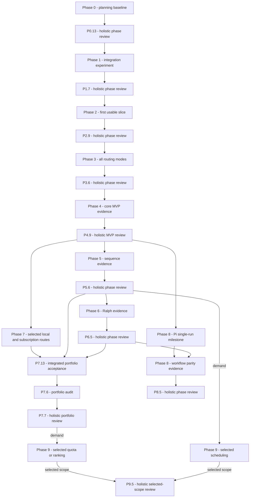

# Project execution plan

D068 implements work package 1 of the [subscription action plan](SUBSCRIPTION_ACTION_PLAN.md): the Phase 7 selected portfolio is existing OpenCode/LiteLLM, Claude and separately gated OpenCode ChatGPT-plan/Go routes. Codex/Grok remain deferred and Antigravity blocked outside mandatory closure. Pi stays independent; F27/F28 stay candidates. PROJECT.md owns current work status; historical phase order below remains traceable.

Planning baseline: 2026-11-01. This turns the phase roadmap into executable work; it does not begin implementation or adopt deferred libraries. [SPECIFICATION.md](SPECIFICATION.md) owns requirements/AC01–AC11, [IMPLEMENTATION.md](IMPLEMENTATION.md) owns phase exit criteria, [PROJECT.md](../PROJECT.md) owns status, and [tasks/](../tasks/README.md) owns per-task dependencies and evidence.

## Milestones and dependencies

Quota requires the selected-portfolio Phase 7 review P7.7 under D068 plus demand and a relevant non-spending usage path; D018 supersedes the earlier first-completed-adapter shortcut. Phase 8 initial single-run support may ship after core MVP; complete workflow parity waits for Phase 6. Quota/ranking and scheduling are independent optional increments; neither blocks core workflows.

## Recommended order and PR boundaries

| Delivery | Recommended task order | Reviewable work packages / gate |
|---|---|---|
| Integration | P1.1 → P1.6 → P1.2 → P1.4 → P1.3 → P1.5 → P1.7 | Scaffold; permission policy; working transport experiment; narrow reuse decision; lifecycle/route evidence; experiment closeout. Permission policy precedes any live prompt. |
| First slice | P2.1 → P2.3 → P2.2 → P2.4 → P2.7/P2.8 → P2.5 → P2.6 → P2.9 | Config/CLI contract; managed sync; vertical run; supervisor/output; diagnostics/project preservation; artifact; real-use gate. Use the slice before expanding. |
| Routing | P3.1 → P3.2 → P3.3 → P3.4 → P3.7 → P3.5 → P3.6 | Failure policy; native isolation; group references then configured fallback as separate PRs if needed; matrix; OpenCode 2.2.5 baseline (D035); use gate. |
| Core MVP | P4.1 → P4.2 → P4.3 → P4.7/P4.8 → P4.4 → P4.5 → P4.6 → P4.9 | Agent schema/emitter/constraints; machine output and capability documentation; role acceptance; release support; AC01–AC11 closeout. |
| Sequences | P5.5 → P5.1 → P5.2 → P5.3 → P5.4 → P5.6 | Trusted checks (first, per the Phase 4 review and D043); state/context decision; ordered execution; durable resume; interrupted live task. |
| Ralph | P6.1 → P6.2 → P6.3 → P6.4 → P6.5 | Completion contract; iteration coordinator; verification/bounds; real completion/non-completion/recovery. |
| Local/subscription portfolio | P7.8 → P7.9 → P7.10 → P7.11/P7.12 → P7.13 → P7.6 → P7.7 | Separate pinned ChatGPT/Go feasibility, then explicit routes in evidence-selected order. Existing local/Claude regression and workflow acceptance P7.13 require P5.6/P6.5. Paused P7.3–P7.5 retain gates outside closure. |
| Pi | P8.1 → P8.2 → P8.3; then P8.4 after P6.5 → P8.5 | Integration decision; adapter; primary/specialized live use; later common-workflow regression. |
| Optional resources | P9.1 → P9.2 if selected; P9.3 independently after P5.6; P9.4 evidence then P9.5 review per selected increment | After P7.7 for quota, or P5.6 for scheduling, demand decision first. P9.5 reviews the entire selected increment set; newly selected work reopens the gate without forcing other optional scope. |

A slash between P2.7/P2.8 or P4.7/P4.8 denotes sibling tasks that are both required; the slash between P7.11/P7.12 denotes separately required routes delivered one at a time in evidence-selected order. It does not authorize simultaneous agents or impose a provider order. Default work-in-progress limit is one active implementation task/PR. Tightly coupled work may share a PR with prerequisite evidence produced before consumption; broad cards should be split into small PRs rather than one phase-sized change. Task IDs remain stable even when work order differs from numeric order.

## Phase review gates

Every phase includes an explicit whole-phase review after acceptance evidence is assembled. Use [PHASE_REVIEW.md](PHASE_REVIEW.md), record all findings/fixes/verification in docs/reviews/, and keep the phase open until no unresolved finding remains and required review/fix PRs merge. These reviews are additional to individual PR reviews. Successor dependencies consume accepted review tasks, not only prior live demonstrations.

## Current execution entry point

P7.8 scope reconciliation has merged. The [P7.9 bounded assessment](evidence/p7-9-chatgpt-feasibility.md) selects installed OpenCode 2.2.5 ChatGPT token-sharing for investigation but leaves feasibility unpassed (D069). The [contained-diagnostic continuation](evidence/p7-9-contained-diagnostics.md) (D070) resolves the spawn/transport blocker and verifies current-host sources plus project/parent canaries and agent rules. The [source/state assessment](evidence/p7-9-source-state-controls.md) (D071) identifies missing system/global exclusions in the selected CLI/server chain and mixed credential/integration persistent state. Its recorded stop condition was met before installed expansion; P7.9 remains unchecked and P7.11 blocked. Resumption needs a separately evidenced safe source-control plan and synthetic persistent-state proof before a D047 exclusive-state login decision. No login-store reads/copies or authentication/session/model calls are authorized. The [P7.10 dedicated Go source assessment](evidence/p7-10-go-feasibility.md) (D072) carries these limits forward and stops before installed checks. Full P7.10 remains unchecked and P7.12 blocked; the inspected allowance query cannot verify Extra Usage off. The [shared source-control design](evidence/p7-9-source-boundary-design.md) (D073) establishes a synthetic macOS data/metadata read-denial candidate under P7.9/D071. D073 planned a separately gated installed no-auth continuation combining D070 transport with that boundary and proving effective resource/synthetic persistent-state controls. The design does not establish installed equivalence or full feasibility for either route. The [pre-launch resource matrix](evidence/p7-9-resource-observation-matrix.md) (D074) meets the stop condition before launch: the current diagnostic allowlist cannot establish complete resource coverage. Next assess official list APIs, initialization/activation and paired inert/static-refusal invariants, including instructions and cached state, before any composed installed proof. Independent Pi continuation remains available. P7.11/P7.12 finalize consuming contracts before production and bounded live acceptance. If feasibility fails, record the blocker and a separate alternative decision rather than weakening the gate.

P7.13 requires accepted P5.6/P6.5 and both route acceptances; it feeds P7.6/P7.7. Pi's P8.2 continuation remains independent under D060/D065 and is not required for portfolio closure. Physical locality and extended fallback require later candidate-promotion decisions (F28 before F27). Optional Phase 9 work still requires explicit demand; P9.1 waits for P7.7 and a supported non-spending usage path, P9.3 for P5.6. See PROJECT.md for mutable status.

## Decision gates

| Before consuming work | Required choice/evidence | Record |
|---|---|---|
| Live transport experiment | P1.1 package/toolchain baseline and P1.6 permission policy | Phase 1 decisions and experiment evidence |
| First-slice writes/launch | Config/input/exit/deadline contracts and transactional project ownership | P2.1/P2.3, CONFIGURATION.md / EXECUTION.md |
| Automatic fallback | Failure eligibility, retry bounds and uncertain-effect handling | P3.1; native isolation in P3.2 |
| Agent/machine interface | Canonical schema/destinations, supported constraints and output version | P4.1/P4.3/P4.7 |
| Durable state | Version/location/concurrency/retention/trust and resume behavior | P5.1/P5.5 |
| Iterative execution | Completion verification and hard iteration/time bounds | P6.1 |
| Subscription routes | Pinned feasibility/control evidence, explicit provider/auth/schema design, account-control limits and separate live gate | P7.9–P7.12; CONFIGURATION.md / EXECUTION.md before consumption |
| New runtime/resource increment | Selected target/use case plus supported integration and constraints | P7.1/P8.1; explicit Phase 9 demand selection |

These gates reference the deferred decision register in DECISIONS.md. Do not resolve every later choice now. If experiment evidence requires a design change, record the decision and update contracts/dependencies before proceeding.

## Risks and evidence checkpoints

| Risk / uncertainty | Earliest owner | Response / required evidence |
|---|---|---|
| OpenCode interface lacks required route/permission control | P1.2/P1.3 | Prove effective behavior; compare the supported structured-output alternative, restrict unsupported paths or record a blocking limitation. Do not build a new agent loop as an implicit workaround. |
| LiteLLM/model alias unavailable | P1.2 | Record sanitized endpoint/model failure and next validation action; continue offline lifecycle/fixture checks but leave live closeout open. |
| Cancelled/disconnected coding has unknown effects | P2.4/P3.1 | Distinct uncertainty outcome and no blind replay; controlled child plus real-use evidence. |
| Managed config conflicts with user/global content | P2.3 | Atomic conflict-aware writes, preserved unrelated settings and no literal keys; sentinel/concurrency tests. |
| Packaging/platform lifecycle differs | P2.5/P4.5 | Advertise only tested targets, smoke actual artifacts and verify cancellation; no universal portability promise. |
| Later adapter mapping broadens restrictions | P4.3/P7.x/P8.2 | Capability checks and explicit refusal; integration evidence per supported version. |
| Planning grows into a second state system | Planning/each closeout | PROJECT.md alone owns task status; static cards own acceptance/dependencies, not runtime queue state or duplicated mutable boards. |

## Definition of done and phase use

A task is done only after its card's deliverable/evidence exists, relevant contracts/decisions are updated, required checks/live observations pass and repository PR/review/merge cleanup is complete. Missing live evidence remains visible. A phase closes only after every mandatory task, its phase-use evidence and the holistic review with resolved/verified findings, not just compilation or mocked tests.

After the first slice and each usable increment, record actual project task, tested versions/route/model, outcome, manual interventions, setup friction, direct-tool comparison and follow-ups in PROJECT.md. Reprioritize from that evidence while preserving MVP policy/constraints. No time estimates or delivery dates are asserted before initial integration provides a basis.
